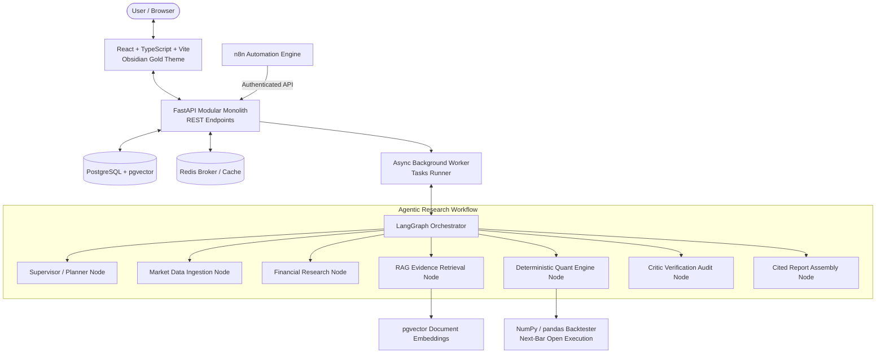

# MarketLab AI

> **Agentic Stock Research, Quantitative Strategy Validation, and Virtual Investment Simulation Platform for Indian Equities**

[](scripts/run_tests.py)
[](docs/ARCHITECTURE.md)
[](docs/DATA_SOURCES.md)
[](frontend/tailwind.config.js)
[](PRD.md)

---

## 1. Executive Summary

MarketLab AI transforms traditional equity analysis into a comprehensive **Agentic Stock Research, Quantitative Strategy Validation, and Virtual Investment Simulation Platform** specifically engineered for Indian capital markets (NSE & BSE).

The platform supports both **short-term trading research** and **long-term investment research** through natural-language directives such as:

> *"I want to invest ₹50,000 in Reliance Industries for six months. Analyze the stock, run multiple strategies, simulate different scenarios, and tell me whether the current price is suitable for entering."*

### Core Architectural Guarantees:
1. **Instrument Resolution**: Resolves natural language queries to authoritative NSE/BSE tickers, ISINs, and AMFI mutual funds across 20,000+ instruments with smart ambiguity detection.
2. **Deterministic Financial Math**: Technical indicators (SMA, EMA, RSI, MACD, Bollinger Bands, ATR, ADX, VWAP, Pivots), DCF intrinsic valuation models, DuPont 3-stage ROE breakdowns, and backtests are executed strictly in verified Python code. LLMs never compute or fabricate financial numbers.
3. **10-Model Quantitative Strategy Ensemble**: Evaluates independently configurable strategies across trend-following, momentum, mean reversion, breakout, and fundamental value, synthesizing an ensemble consensus vote (BUY/HOLD/SELL/INSUFFICIENT EVIDENCE).
4. **Virtual Investment Environment**: Risk-free paper trading portfolios with real-time mark-to-market position tracking, realistic STT/brokerage fees, slippage, and What-If market stress tests (e.g. -15% correction, +20% rally).
5. **Traceable Citations & Critic Gate**: Qualitative assertions link directly to audited regulatory filings, annual reports, and corporate announcements stored in pgvector. An adversarial Critic Agent verifies factual consistency and flags look-ahead bias.
6. **Obsidian Gold SaaS Identity**: Institutional dark theme (`#09090B` background, `#D4AF37` gold accents, `#303036` borders) with tabular figures, responsive equity charts, and SEBI statutory disclosures.

---

## 2. System Architecture



---

## 3. Repository Structure

```
MarketLab/
├── .env.example                # Configured environment variables template
├── .gitignore                  # Git exclusions
├── docker-compose.yml          # Multi-container stack (Postgres, Redis, Backend, Worker, Frontend, n8n)
├── README.md                   # System documentation & setup guide
├── PRD.md                      # Product Requirements Document
├── docs/
│   ├── ARCHITECTURE.md         # Detailed architectural design & boundaries
│   ├── API.md                  # REST API contract and endpoint specifications
│   ├── DATA_SOURCES.md         # Market data licensing & governance for Indian equities
│   ├── EVALUATION.md           # Evaluation suite & adversarial quality gates
│   └── PRD.md                  # Architectural PRD copy
├── automation/
│   └── workflows/
│       ├── market_data_ingestion.json      # n8n scheduled Bhavcopy daily ingestion
│       ├── research_execution.json         # n8n authenticated research trigger
│       └── completion_notification.json    # n8n report completion alerts
├── backend/
│   ├── Dockerfile              # Backend container specification
│   ├── requirements.txt        # Pinned Python dependencies
│   ├── alembic.ini             # Database migration configuration
│   ├── app/
│   │   ├── main.py             # FastAPI entry point & lifespan handler
│   │   ├── api/v1/             # REST endpoints (research, instruments, experiments, documents, internal)
│   │   ├── core/               # Settings, security dependencies, logging, exceptions
│   │   ├── db/                 # SQLAlchemy models & repositories
│   │   ├── schemas/            # Pydantic v2 schemas
│   │   ├── services/           # Quantitative engine, instrument resolver, market data, RAG
│   │   ├── providers/          # Market data adapters, LLM adapters (OpenAI, Gemini, Mock)
│   │   ├── agents/             # LangGraph state machine & specialized workflow nodes
│   │   ├── rag/                # Semantic chunker, embeddings, and vector retriever
│   │   └── worker/             # Background research execution engine
│   └── tests/                  # 20 automated pytest unit, integration, and AI eval tests
├── frontend/
│   ├── Dockerfile              # Production Nginx frontend container
│   ├── package.json            # Vite, React 18, Tailwind CSS, Lucide icons
│   ├── tailwind.config.js      # Obsidian Gold design token definitions
│   └── src/
│       ├── components/         # Navbar, Sidebar, MetricCard, WorkflowStepper, ReportViewer, EquityChart
│       ├── pages/              # Overview, Stock Research, Strategy Lab, Compare, Library, Experiments, Settings
│       └── services/           # Typed API service client
└── scripts/
    ├── seed_data.py            # Database initializer & instrument seeder
    └── run_tests.py            # Master test runner (Backend pytest + Frontend build)
```

---

## 4. Quickstart Guide (Windows PowerShell & Linux)

### Prerequisites
- Python 3.10+ (tested on Python 3.14 x64 on Windows)
- Node.js 18+ and npm
- Docker and Docker Compose (optional for containerized deployment)

### 4.1 Running with Docker Compose
To start the entire platform (PostgreSQL with pgvector, Redis, FastAPI Backend, Background Worker, React Frontend, and n8n):
```bash
# 1. Copy environment template
cp .env.example .env

# 2. Launch all services
docker compose up --build
```
- **Web Application**: `http://localhost:3000`
- **FastAPI Swagger Docs**: `http://localhost:8000/docs`
- **n8n Automation Console**: `http://localhost:5678` (Credentials: `admin` / `marketlab_admin`)

### 4.2 Running Locally on Windows PowerShell

#### Step 1: Clone & Configure Environment
```powershell
# Copy the environment template
Copy-Item .env.example .env

# Edit .env with your provider choices:
# For real historical daily data: MARKET_DATA_PROVIDER=yfinance
# For offline unit tests: MARKET_DATA_PROVIDER=fixture, LLM_PROVIDER=mock, EMBEDDING_PROVIDER=mock
# For live Gemini LLM: LLM_PROVIDER=gemini, GEMINI_API_KEY=AIzaSy...
```

#### Step 2: Install Backend Dependencies & Start Server
```powershell
# Install pinned dependencies
python -m pip install -r backend/requirements.txt

# Start FastAPI backend server (Runs on port 8000)
cd backend
python -m uvicorn app.main:app --host 127.0.0.1 --port 8000 --reload
```

#### Step 3: Install Frontend Dependencies & Start Dev Server
In a separate PowerShell window:
```powershell
cd frontend
npm install
npm run dev -- --host 127.0.0.1 --port 5173
```
Access the application at `http://127.0.0.1:5173`.

---

## 5. Verification & Test Suite

MarketLab AI provides strict separation between **offline unit tests** (which mock external network boundaries) and **opt-in live integration tests** (which hit live Yahoo Finance and Google Gemini endpoints).

### 5.1 Running the Master Offline Test Suite
Executes all 33 unit and evaluation tests plus full TypeScript compilation and Vite production bundle check:
```powershell
python scripts/run_tests.py
```

### 5.2 Running Opt-In Live Integration Tests
Gated by `$env:RUN_LIVE_INTEGRATION_TESTS="true"`. Requires an active internet connection:
```powershell
# Enable the live integration test gate in PowerShell
$env:RUN_LIVE_INTEGRATION_TESTS="true"

# Test live market data retrieval (Yahoo Finance - GREENPOWER.NS)
python -m pytest backend/tests/test_live_integration_gated.py -k "test_live_market_data" -v

# Test live Gemini LLM & Embeddings (Requires GEMINI_API_KEY in environment)
$env:GEMINI_API_KEY="AIzaSyYourActualKey"
python -m pytest backend/tests/test_live_integration_gated.py -v
```

---

## 6. Troubleshooting & Provider Error Guide

| Symptom / Error | Root Cause | Solution |
|---|---|---|
| `ConfigurationError: GEMINI_API_KEY is not configured` | Live mode (`LLM_PROVIDER=gemini` or `EMBEDDING_PROVIDER=gemini`) is active without an API key. Silent mock fallback is forbidden in live mode. | Add `GEMINI_API_KEY=AIzaSy...` to `.env` or switch to offline mode: `LLM_PROVIDER=mock` and `EMBEDDING_PROVIDER=mock`. |
| `MarketDataProviderError: No historical market data returned` | Ticker not recognized or Yahoo Finance rate limit/timeout. | Verify instrument symbol mapping. `yfinance` employs bounded retries with exponential backoff (up to 3 attempts). |
| `MarketDataProviderError: Direct NSE/BSE exchange API credentials not configured` | Direct exchange adapter (`MARKET_DATA_PROVIDER=nse_bse`) selected without authorized exchange credentials. | Set `MARKET_DATA_PROVIDER=yfinance` for daily historical bars or `fixture` for offline testing. |
| Mixed vector collection warning in UI | Some document chunks have mock embeddings while others have Gemini embeddings. | Go to **Settings** page and click **"Rebuild Vector Index"** or send `POST /api/v1/system/reindex` to re-embed all chunks uniformly. |
| AppLocker / PowerShell script execution policy error | Local virtualenv binaries blocked by Windows Application Control. | Run packages via system python: `python -m pip install ...` and `python -m pytest ...`. |

---

## 6. n8n Automation Workflows

Import the pre-configured workflow JSON files in `automation/workflows/` directly into your n8n console (`http://localhost:5678`):
1. **`market_data_ingestion.json`**: Scheduled daily trigger at 16:30 IST calling `/api/v1/internal/ingestion-jobs` with authentication headers and retry backoff.
2. **`research_execution.json`**: Authenticated webhook trigger to queue research requests and log queue status.
3. **`completion_notification.json`**: Dispatches notifications with sentiment badges, executive summaries, risk factors, and citation links upon report completion.

---

## 7. Legal & Regulatory Disclaimer

**MarketLab AI is an evidence-backed decision-support and educational research tool.**
- It is **not** a SEBI-registered Investment Adviser, Research Analyst, or Portfolio Manager.
- It does **not** provide personalized financial advice, guarantee profitability, or execute live stock market orders.
- Historical backtest results reflect theoretical performance with specified fee and slippage assumptions; past performance is never a guarantee of future returns.
