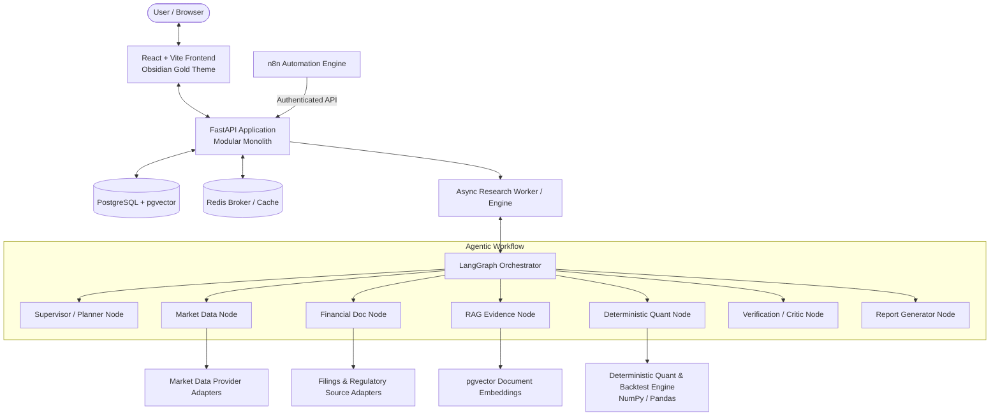

# MarketLab AI — System Architecture

## 1. System Overview

MarketLab AI is an agentic stock research and strategy validation platform designed for Indian equities. It enforces a strict boundary between probabilistic LLM agent orchestration and deterministic quantitative execution.

## 2. Core Architectural Principles

1. **No LLM Hallucinated Calculations**: LLMs interpret intent, formulate research plans, coordinate nodes, and synthesize narratives. All numerical indicators (SMA, EMA, RSI, MACD, Sharpe, Drawdown) and backtest mechanics (fill price, slippage, brokerage, cash balance) are calculated exclusively in deterministic Python code.
2. **Compact Graph State**: Large OHLCV series and bulk text are stored in database records or memory caches. LangGraph state carries instrument metadata, references, validated metrics, and retrieved evidence snippets.
3. **Traceable Citations**: Every factual claim in the generated research report must reference an ingested document with source identifier, timestamp, publication date, and page/section where available.
4. **Adversarial Verification**: Before any research report is finalized, a Critic / Verification agent checks source freshness, calculation consistency, benchmark appropriateness, and look-ahead bias risk.
5. **Obsidian Gold SaaS Aesthetics**: Dark mode palette (#09090B background, #111114 surface, #18181B cards, #D4AF37 gold accents) optimized for financial readability with tabular figures and responsive layout.

## 3. Component Details

### 3.1 Backend Architecture (`backend/app/`)
- `api/v1/`: REST endpoints for research, market data, instruments, experiments, documents, and health checks.
- `core/`: Application settings (Pydantic Settings), security (API keys, JWT), logging, and custom exceptions.
- `db/models/`: SQLAlchemy 2.0 ORM models for instruments, market bars, financial facts, documents, chunks, research runs, reports, experiments, and automation events.
- `db/repositories/`: Data access layer separating database operations from business logic.
- `schemas/`: Pydantic models for strict request/response validation and LangGraph typed state.
- `providers/`:
  - `market_data/`: Provider abstraction (`BaseMarketDataProvider`) with fixture fallback and Indian equities adapters (NSE/BSE).
  - `llm/`: Configurable LLM adapter (OpenAI, Gemini, or Mock for deterministic testing).
  - `document_source/`: Ingestion for exchange disclosures, annual reports, and investor filings.
- `agents/`: LangGraph state machine with typed state, dedicated workflow nodes (`planner`, `market_data`, `financial_research`, `rag`, `quantitative`, `verifier`, `report`), prompts, and structured output parsers.
- `rag/`: Text chunker, embedding generator, pgvector retriever, and evaluation harness.
- `worker/`: Background job execution engine for long-running research runs and backtests.

### 3.2 Quantitative & Backtesting Engine (`backend/app/services/quantitative_engine.py`)
- Vectorized and event-driven indicator calculations using NumPy and pandas.
- Standard metrics: Returns, Annualized Volatility, Sharpe Ratio, Sortino Ratio, Maximum Drawdown, Calmar Ratio, Win Rate, Profit Factor.
- Backtest execution: Configurable SMA crossover (e.g., 20/50), explicit cash allocation, trade sizing, transaction fees (e.g., STT, brokerage, exchange fees), and execution slippage.
- Look-Ahead Bias Prevention: Next-bar open execution upon signal generation; chronological training/testing partitions.

### 3.3 Frontend Architecture (`frontend/src/`)
- React 18/19 with TypeScript and Vite.
- Tailwind CSS configured with the Obsidian Gold design system.
- Modules:
  - **Overview**: Market snapshot, system status, quick research prompts.
  - **Stock Research**: Interactive research workspace, real-time workflow stage stepper, cited report viewer.
  - **Strategy Lab**: Natural-language and manual parameter strategy builder, equity curve charts, drawdown metrics.
  - **Compare Stocks**: Side-by-side financial and technical comparison.
  - **Research Library**: Historical research reports with verified citation inspection.
  - **Experiment History**: Re-runnable strategy backtests with audit trails.
  - **Settings**: Provider keys, demo mode toggles, risk parameters.
